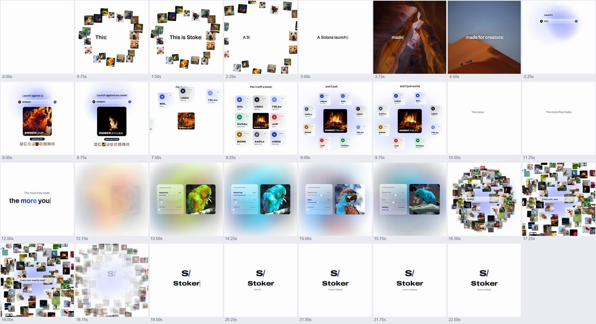

# AI lab launch

A 20 to 25 second square product launch film in the style of an AI lab's model launch.

## The look

A white page, one typeface, ink-black type and real photographs.
Every caption is typed word by word at the exact moment the voice says it, with a caret that glides behind the letters.
The controls (a prompt bar, a settings panel, a caption pill) are liquid glass: the scene behind is frosted, the edge bends it like thick glass, and a top sheen, bright rim and soft lift shadow sit on top.
A slow pastel aura in the brand colours sits behind the glass, because glass on plain white shows nothing.
The words the voice stresses type in the brand gradient with a faint glow, and every grey on the page is the brand's own ink.
The camera always drifts (a 1.00 to 1.04 push per scene), nothing pops in (every fade is at least 0.3 s and eased), images switch on 16th notes, and every frame carries 8-subframe motion blur.

## The sound

One female voice, read in one take and tightened so no pause is longer than 0.2 s.
A royalty-free electronic track starts so its drop lands on the voice's verb line ("Launch against ANY asset").
The music ducks under the voice with a 3-band sidechain, solved per phrase so the voice sits 9 dB over the music between 300 Hz and 4 kHz.
A click on every image switch, a key on every typed letter, a soft landing on the stressed word, whooshes on the big moves, impacts on the drop and the logo.
Mastered to -14 LUFS with true peaks under -1 dBTP.

## When to use it

Use it for a product, model or app launch that has a short pitch, a real input and output, and a few settings to show.
It suits anything that can be shown as "you give it X, it gives you Y, you tune Z".
It is the wrong choice for a story, an explainer with many steps, or anything longer than about 30 s: the shape is nine spoken lines and seven scenes.

## Examples

| Film | Source | Export | Length | Size |
| --- | --- | --- | --- | --- |
| Stoker launch (Solana launchpad, 2026-10-05) | `videos/stoker-launch/` | `stoker-launch.mp4` | 23.0 s | 1440x1440, 60 fps |
| Stoker coming soon (same product, Furnace palette, 2026-10-09) | `videos/stoker-coming-soon/` | `stoker-coming-soon.mp4` | 22.25 s | 1440x1440, 60 fps |

The template in `template/` is the second film with its content in `config.json`, and it re-renders it pixel for pixel; the first film's folder keeps its own code.
The second film added a price chart in the result card, a counting glass pill, choice sliders, the address under the closing line, brand-derived greys, a storyboard tool and a measured text check, all driven from the config.
It was inspired by a reference film made for an image model ("Ora 2") by another creator; that film is not in this repository.

## Stack

An HTML canvas where every frame is a pure function of time, rendered with Playwright at 60 fps with 8 motion-blur subframes and piped to ffmpeg.
ElevenLabs for the voice, faster-whisper for word timings, numpy and scipy for the sidechain mix and limiter, ffmpeg for loudness.

## Files

- `BRIEF.md`: the prompt to start a new film.
- `PLAYBOOK.md`: the process step by step and every gotcha.
- `template/`: the working code and `config.json`.
- `reference/`: the contact sheet and the eight review stills, from the first film.
