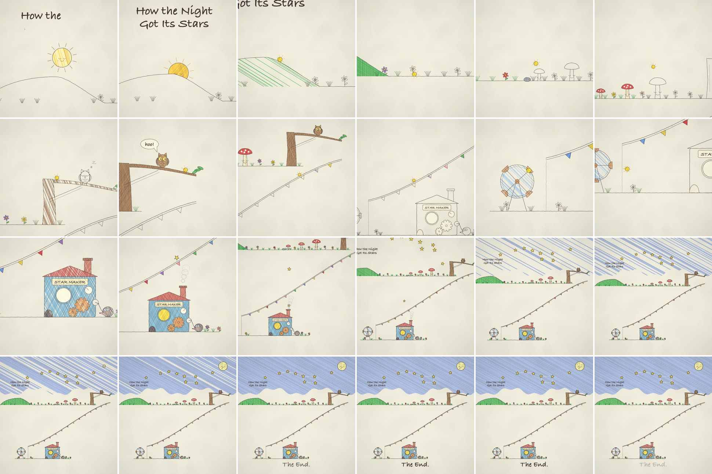

# cairo-night-sky

A hand-drawn picture-book chain reaction, drawn frame by frame in Python with pycairo, that ends with the whole world pulling back under a crayon night sky.

## The look

A warm cream page with very soft, low-frequency paper blotches and a faint vignette, never visible grain.
Everything starts as soft brown-black pencil line art whose outlines "boil" through three jittered poses at 8 poses per second, so the drawing feels alive even when nothing moves.
Each object gets coloured in with diagonal crayon hatching the moment the hero reaches it: strokes appear in random order, and a second cross-hatch layer follows, in saturated nursery colours (tomato red, grass green, sky blue, sunflower yellow, copper, pink and purple).
The hero is a small glowing yellow spark with spinning rays and a sparkle trail, and it rolls, bounces and rides through a Rube Goldberg chain of cute contraptions: a sleepy sun setting behind a hill, three squashy mushrooms with faces, a dozing owl on a branch who wakes up with a "hoo!" bubble, a long bunting slide, a water wheel, and a "STAR MAKER" machine cranked by a mole in goggles.
One continuous camera, no cuts, follows the spark at close zoom, then pulls back to a wide shot of the whole world while blue crayon hatching fills the top of the screen like night falling.
Stars fly out of the chimney one by one, land in the sky, get joined by dashed constellation lines, a smiling moon pops in, and "The End." fades up.
Lettering is Bradley Hand Bold, the title is wiped on in the world above the first shot and is left there, so it reappears small in the sky in the final frame.

## The sound

A gentle C major lullaby at 96 bpm with no voice: a swelling string pad, a celesta melody, soft sampled grand piano arpeggios (Salamander Grand through sfizz), pizzicato bass and a music box opening, with flute doubling the tune in the final third.
Every on-screen event has its own cue on the exact frame: a harp glissando when the spark pops in, a wood block, celesta note and pizzicato on each mushroom bounce, a bassoon "hoo" for the owl, a rising pentatonic harp run down the slide, music-box ratchet ticks on the wheel, tremolo strings and a soft quickening heartbeat kick while the machine works, a harp pluck per star launch and a celesta ping per landing, a triangle for the finale and a harp arpeggio for the moon.
Very quiet filtered-noise whoosh, rumble and ticks sit under the score.
Algorithmic reverb from pedalboard, mastered to about -15 LUFS with the peak near -4 dBFS.

## When to use it

- Children's "just so" stories in the shape "How the X Got Its Y", bedtime shorts and gentle origin stories.
- Cause-and-effect explainers where one small thing sets off a chain that makes something delightful.
- Square social posts of 30 to 60 seconds that need no narration and no captions.

## When not to use it

- Anything that needs a voice-over, captions or dialogue: there is no voice pipeline here.
- Data, product UI or technical explainers, brand-exact visuals, photoreal or fast-cut hype edits.
- Long videos: every prop, path and camera key is hand-placed in code, so the work grows with every second of story; beyond about 90 seconds split it into chapters.

## Finished examples

| Source folder | Export | Length | Size | fps |
| --- | --- | --- | --- | --- |
| `videos/night-stars/` | `how-the-night-got-its-stars.mp4` in the workspace root (same file as `videos/night-stars/night-stars.mp4`) | 48.0 s | 1080x1080 | 30 |

H.264 at CRF 16 with AAC 192 kb/s stereo, about 21 MB.
It was made after studying a crayon chain-reaction short that Kevin Ngo drew in code; a copy of that video sits in the workspace root and is not part of this repository.

## Stack

pycairo frames (multiprocessing pool) piped as raw BGR to ffmpeg libx264; score written as raw MIDI in Python, piano rendered by sfizz with Salamander Grand and the rest by fluidsynth with MuseScore General, mixed and mastered with pedalboard and numpy.

## Reference

- `reference/contact_sheet.jpg`: one frame every 2 s of the finished export.
- `reference/still_09s_mushrooms.jpg`: pencil-only mushrooms waiting, the first one already coloured in.
- `reference/still_14s_owl.jpg`: the owl wakes with a "hoo!" as the spark rolls past.
- `reference/still_25s_star-maker.jpg`: the spark has dropped into the machine; the mole cranks it.
- `reference/still_38s_finale.jpg`: the wide shot under the crayon night sky, constellation and moon.

## Files

- `BRIEF.md`: the prompt to start a new video in this style.
- `PLAYBOOK.md`: the steps, checks and every gotcha.
- `template/`: the working code; see `template/README.md` for commands.
