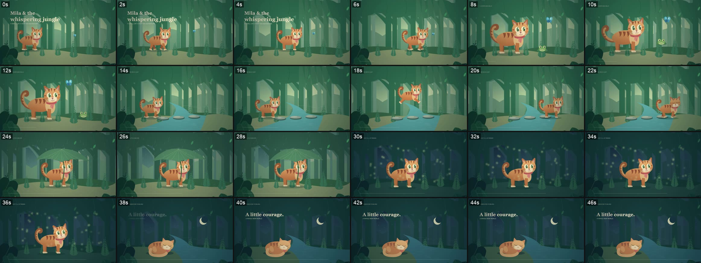

# Narrated storybook

A gentle picture-book short: one small hero, six places, a warm narrator reading a 100-word story over a quiet bed of jungle sound.

## The look

Full-bleed 1920x1080 flat-vector illustration, painted live in Canvas 2D with no images at all: a jungle of three parallax layers of trunks and rounded canopy blobs, ridges, ferns, a soft radial vignette, and dark monstera leaves and dangling vines framing every shot.
The hero is a round-faced amber tabby with a cream muzzle, big green eyes, dark stripes and a coral neckerchief, drawn from ellipses and Bezier paths with articulated paws, a swishing tail, blinks and head tilts.
Each scene is one locked-off wide shot with a single readable action (walking in, a startle at a frog, a leap across stepping stones, sheltering under a giant leaf, standing among fireflies, curled up asleep), joined by straight editorial cuts with no blank cards.
The colour runs from jade dawn with pale god rays, through a turquoise river and blue-grey rain, to an indigo and teal night with fireflies, stars and a crescent moon.
Type is a bold Georgia serif for the opening title and the closing line, a small tracked sans chapter label at the top left ("03 / ONE BRAVE LEAP"), and a thin cream progress line that grows along the bottom for the whole film.
There are no captions: the narration carries the words.

## The sound

One narrator, a warm female storyteller with a gentle British accent (Gemini 3.8 Flash TTS, voice Sulafat), reads the story as six lines, one per scene, each starting a beat after the cut.
The clips are loudness-normalised to -18 LUFS each and sped up 1.16x with pitch-preserving `atempo` so the film lands on exactly 47 seconds.
Underneath sits an original procedural bed generated in Node: low air, short bird chirps, river water in the river and night scenes, a rain wash with one thunder roll, and night insects, at 0.32 volume with fades at both ends.
There is no music.
The export measures -15.2 LUFS integrated with a -1.9 dBTP peak.

## When to use it

- Bedtime stories, fables and gentle character journeys of 30 to 90 seconds, told in a handful of places.
- When a calm narrator should carry the story and the pictures should illustrate it, page by page.
- When nothing can be downloaded or licensed: every image and every non-voice sound is generated by code.

## When not to use it

- Word-synced captions or kinetic type: this style never uses word-level timings (see PLAYBOOK.md).
- Fast promos, explainers with diagrams, data, or anything photoreal.
- Music-led edits: there is no score and no beat grid.
- Vertical or square video: every coordinate is laid out for 1920x1080.
- A hero that is not a cat, unless you budget for new character drawing code; the cat is the largest piece of art in the engine.

## Finished example

| | |
| --- | --- |
| Source | `videos/mila-jungle/` |
| Export | `mila-jungle-47s.mp4` in the workspace root |
| Length | 47.0 s, 1128 frames |
| Format | 1920x1080, 24 fps, H.264 with AAC 48 kHz stereo |
| Story | "Mila and the whispering jungle", 104 words in six scenes |

## Stack

Canvas 2D painter (`scene-renderer.js`) driven by GSAP timelines inside HyperFrames 0.8.106 HTML compositions, Gemini TTS narration fitted with ffmpeg `atempo` and `loudnorm`, verified word for word by whisper.cpp on the CPU, procedural Node ambience.

## Reference images

- `reference/contact_sheet.jpg`: one frame every 2 s of the finished export.
- `reference/still-01-title-dawn.jpg`: opening title over the dawn walk.
- `reference/still-02-river-leap.jpg`: the leap across the stepping stones.
- `reference/still-03-rain-shelter.jpg`: sheltering under the leaf in the rain.
- `reference/still-04-night-home.jpg`: the closing line over the sleeping cat.

The stills come from the original export, so they show three defects the template has since fixed: vines cutting through the chapter labels, the leaf stem crossing the cat's face, and a dark disc around the crescent moon (PLAYBOOK.md, gotchas 6 to 8).

## Files

- `BRIEF.md`: the prompt to start a new video in this style.
- `PLAYBOOK.md`: setup, the steps with commands, the checks, and every gotcha found.
- `template/`: the working project to copy into `videos/<name>/`.
