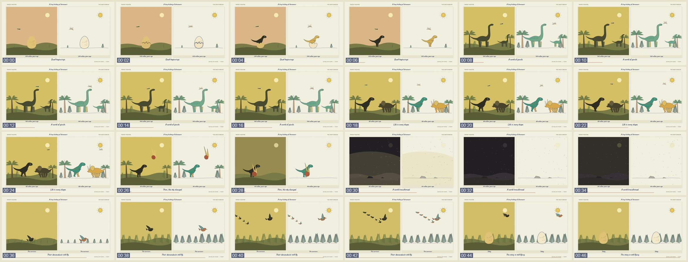
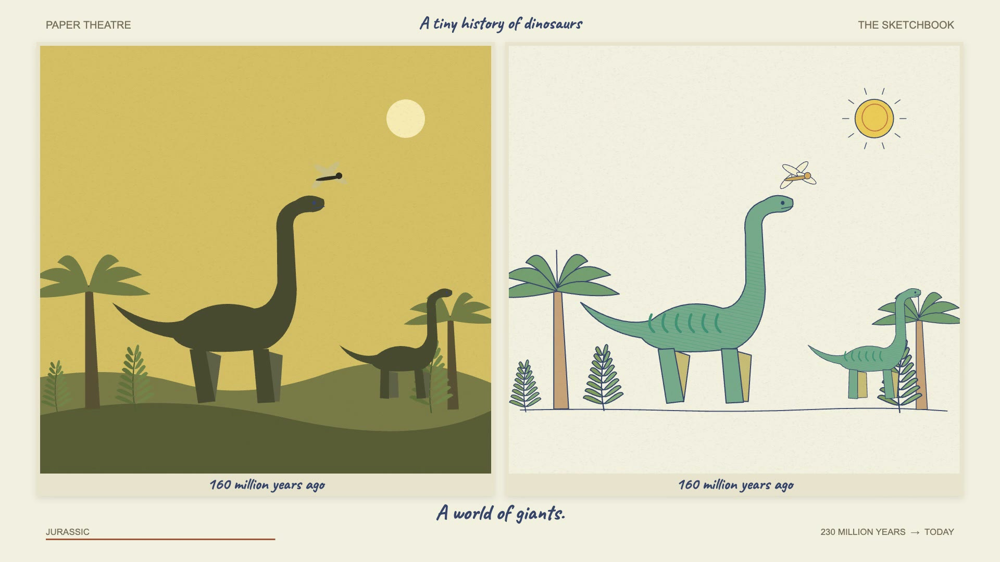

# Paper theatre and sketchbook

A short explainer told twice at once, in two synchronized panels on one warm ivory page.

## The look

A 1920x1080 ivory page (#f4f0df) holds two square mounted cards side by side, each with a soft drop shadow.
The left card, labelled PAPER THEATRE, is a flat paper-cutout diorama: dark olive and charcoal silhouettes against a coloured sky (peach, then ochre, then near-black for a dramatic beat) over two layered rolling hills.
The right card, labelled THE SKETCHBOOK, shows the exact same scene on plain sketch paper, with navy ink outlines, a faint offset second stroke, diagonal pencil hatching and soft greens, teals, ochres and rusts.
Both panels share one set of drawings, so every character moves identically on both sides, and the pairing is the whole idea.
Characters are simple articulated cutouts: legs swing on sines, heads and tails pivot, wings flap, and a seeded paper-fibre speckle sits over both panels.
The sketchbook panel boils very gently (the whole drawing re-poses 8 times a second by about 1 px).
Text is handwritten Caveat in navy ink: the title at the top, the same short label under each panel, and one caption line under both.
Small quiet sans labels frame the page (panel names on top, the chapter name and a "from -> to" range at the bottom), and a thin rust progress line grows along the bottom edge.
There are no camera moves and no scene cuts: the stage holds still and the story changes inside it.

Stills: [12 s, giants](reference/still-12s.jpg), [27 s, the visitor](reference/still-27s.jpg), [31 s, impact winter](reference/still-31s.jpg), [39 s, the survivors](reference/still-39s.jpg).

## The sound

The example runs on one gentle instrumental bed with no voice and no sound effects.
Measured rather than auditioned: it is soft and warm (spectral centroid about 750 Hz), leans on D major, sits around 96 BPM with sparse note onsets (under 2 per second), builds through the middle of the story, drops to its quietest for the dark beat and swells again for the ending.
It masters at about -19 LUFS integrated with an 11 LU loudness range and a -5.6 dBFS true peak.
That bed was lifted from the video that inspired this one, so it is not reusable: a new video needs its own licensed or self-composed track (see PLAYBOOK.md).

## When to use it

- A short (30 to 90 seconds) story with a clear arc of 5 to 8 beats: a history, an origin, an evolution, a "how X became Y".
- Topics that suit simple silhouettes and nature-diagram drawing: animals, plants, landscapes, simple machines, buildings, the sky.
- Pieces with no narration, carried by one caption line per beat and music.
- When a calm, handmade, museum-placard tone is wanted.

## When not to use it

- Narrated explainers with dense facts, charts, numbers or code: the page has room for one short caption per beat.
- Vertical or square formats: the twin-panel layout is built for 16:9 and needs a redesign for anything else.
- Fast, punchy promos or anything that needs camera moves, cuts or photographic material.
- Topics whose subjects cannot be drawn as a few dozen flat Canvas paths (people's faces, UIs, logos).

## Finished example

| | |
| --- | --- |
| Source folder | `videos/dinosaur-history/` |
| Export | `dinosaur-history.mp4` in the workspace root |
| Length | 47.5 s |
| Resolution | 1920x1080 |
| Frame rate | 24 fps |
| Audio | AAC, the soundtrack extracted from the inspiration video |

The template in `template/` rebuilds this example from `config.js` and `scenes.js`, with a few fixes the original export lacks (smooth colour changes and cross-dissolves at beat edges; see PLAYBOOK.md).

## Stack

Canvas 2D drawn as a pure function of time inside a HyperFrames 0.8.140 HTML composition, driven by one paused GSAP timeline and rendered with `npx hyperframes render`.
