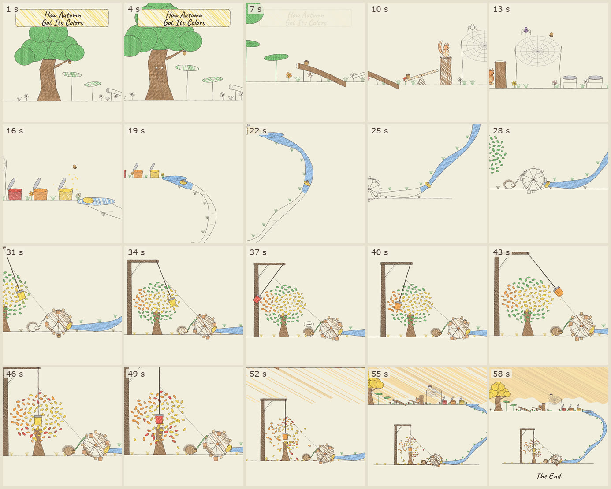
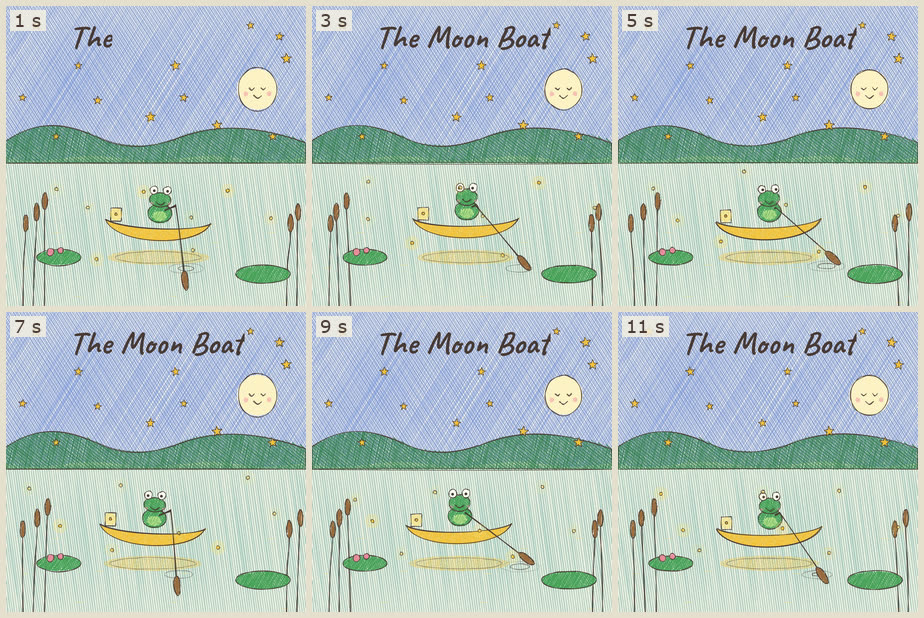

# Pencil storybook

## The look

Every frame looks like a children's picture book drawn live with a soft pencil and a box of crayons on warm cream paper.
Outlines are a dark brown-grey pencil line with a faint second pass beside it, and they "boil": the wobble is redrawn 8 times a second through a cycle of 3 poses, so the drawing feels alive even when nothing moves.
Shapes are coloured in with loose diagonal crayon hatching in bright, slightly warm tones (leaf green, tomato red, pumpkin orange, sunflower gold, sky blue, bark brown), and a second cross-hatch layer appears where a shape is fully coloured.
The hatching never boils, and it can be revealed stroke by stroke in random order, so props and whole landscapes colour themselves in on screen when the story reaches them.
Most of the page stays bare paper, which keeps the eye on the one thing moving.
Characters are built from ellipses with dot eyes and arc smiles (an oak with a face, a squirrel, a spider, a hedgehog with a "yum!" speech bubble).
The film is one continuous world with no cuts: a smoothed camera glides and zooms along a chain-reaction path, then pulls far back at the end to reveal the whole machine under a crayoned sunset sky.
Titles are handwritten in Caveat on a lightly hatched paper banner, and the film fades in from paper and back out to paper after a handwritten "The End.".

## The sound

A wordless, whimsical chamber-orchestra score in A minor and C major (Am, F, C, G) at 96 bpm, written note by note in code and played by a General MIDI soundfont.
A music box opens under the title, a celesta tune rides a light nylon-guitar and pizzicato bed, the tune passes to flute, clarinet and piano as the story moves, strings and horn swell for the climax, and a choir and harp rise for the finale.
Every bounce, launch and pop in the picture has its own short cue (marimba hits, harp runs, a pizzicato "boing", a bassoon "yum", a timpani roll), timed from the same numbers that drive the animation.
There is no narration and no sound-effects library: every sound is a MIDI note.
A synthetic concert-hall reverb glues it together, and the master sits at -15 LUFS with a -2 dBTP ceiling.

## When to use it

- Wordless fables and "how X got its Y" origin stories for children, 12 to 60 seconds long.
- Cause-and-effect or Rube Goldberg chains, where one object travels through a world and sets things off.
- Square social posts that should feel handmade, warm and calm.
- Any video that must be built entirely from code, with no stock assets, no API keys and no voice.

## When not to use it

- Anything with narration, dialogue or lip sync (use a narrated storybook style instead).
- Night scenes or dark palettes: the look depends on bright paper (the cairo night-sky style covers night).
- Fast-cut promos, product launches, data or text-heavy explainers.
- Photoreal or brand work that needs exact logos and type.

## Finished examples

| Example | Source | Export (workspace root) | Length | Size | fps |
| --- | --- | --- | --- | --- | --- |
| How Autumn Got Its Colors (main) | `js-kit/autumn/` | `how-autumn-got-its-colors.mp4` (MuseScore_General); soundfont variants `how-autumn-got-its-colors_arachno.mp4` and `how-autumn-got-its-colors_timbres-of-heaven.mp4` | 60 s | 1080x1080 | 30 |
| The Moon Boat (earlier, single scene) | `js-kit/moon-boat/` | `moon-boat-js.mp4` | 12 s | 1080x1080 | 30 |

The autumn film is the reference for this style, and `template/` is built from it.
The Moon Boat came first: one static scene with ambient motion (a frog rowing, fireflies, twinkling stars), drawn with roughjs instead of the custom pen, with full-bleed hatched sky and pond.

## Stack

skia-canvas frames from a custom pencil-and-crayon pen (`lib.mjs`), piped as raw RGBA to ffmpeg in parallel segments; a midi-writer-js score rendered by spessasynth_core with a General MIDI soundfont; ffmpeg convolution reverb, loudnorm and mux.

## Reference stills

| File | Time | What it shows |
| --- | --- | --- |
| `reference/autumn_4_5s.jpg` | 4.5 s | Title banner, the surprised oak and its dense hatching, leaf trampolines half coloured in. |
| `reference/autumn_10_2s.jpg` | 10.2 s | The log ramp, seesaw, squirrel on its stump and the spider web; lots of bare paper. |
| `reference/autumn_37_0s.jpg` | 37.0 s | The pendulum paintbrush colouring the maple, the water wheel and the hedgehog's "yum!". |
| `reference/autumn_56_5s.jpg` | 56.5 s | The final pull-back over the whole machine under the crayoned sunset, with "The End.". |
| `reference/contact_sheet.jpg` | 1 to 58 s | The autumn film, one frame every 3 s. |
| `reference/moon_boat_sheet.jpg` | 1 to 11 s | The Moon Boat, one frame every 2 s. |

## In this folder

- `BRIEF.md`: the prompt to paste to start a new video in this style.
- `PLAYBOOK.md`: setup, the steps with commands, the checks, and every gotcha found so far.
- `template/`: the working code; copy it to `js-kit/<name>/` (see `template/README.md`).
